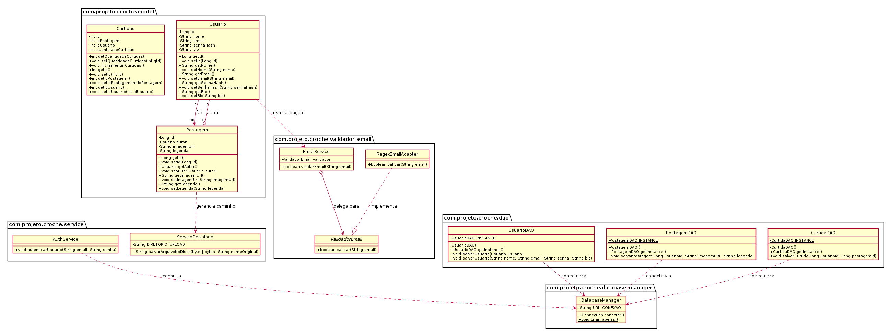

# Projeto_Rede_Social_Crocheteiras
Projeto Piloto para construir uma rede social para crocheteiras

## Arquitetura e Modelagem de Classes

Abaixo está o diagrama UML atualizado das classes do sistema:

_Fase 1 (O Monólito Inicial): Comece criando um monólito simples onde as usuárias conseguem se cadastrar, fazer login, criar um perfil ("Crocheteira Master") e postar uma foto de crochê com legenda._

    Passo 1: Defina o Escopo Mínimo (O "MVP")
    Autenticação: Cadastro e Login de usuárias (com perfil diferenciado, ex: "Artesã" e "Visitante").
    Publicação: Uma tela simples onde a crocheteira consegue subir uma foto e escrever uma legenda sobre a peça que produziu.
    Feed Básico: Uma página principal que lista todas as fotos postadas em ordem cronológica.

    Passo 2: Escolha a Tecnologia Base (O Monólito)
    Crie um único projeto (monólito) usando a stack com a qual você quer se habituar ou consolidar conhecimentos.

    Passo 3: Coloque a Mão na Massa (Primeiro Código)
    Crie o repositório do projeto no seu GitHub.

    Objetivo: Faça funcionar o ciclo básico: cadastrar uma usuária, fazer login e conseguir salvar um post no banco de dados.

_Fase 2 (A Escala e os Problemas): Simule que a plataforma cresceu. O feed começou a travar porque tem muita gente acessando junta. O que você faz? Introduz uma camada de cache (Redis)._

_Fase 3 (A Divisão): O módulo de chat em tempo real e o módulo de upload de imagens começam a pesar no servidor principal. Você decide aplicar o que o vídeo ensina: quebra o monólito e transforma essas partes em microsserviços que se comunicam por filas de mensagens (Kafka ou RabbitMQ)._

